<div align="center">



# 📡 Awesome Real-Time Regulatory Change Monitors

**A curated index of SaaS intelligence platforms, open-source RegTech tools, and compliance-as-code frameworks for 24/7 horizon scanning, automated control mapping, and regulatory change management.**

<p align="center">
  <a href="https://github.com/ishandutta2007/Awesome-Awesome-Awesome"></a>
  <a href="https://discord.gg/jc4xtF58Ve"></a>
  <a href="LICENSE"></a>
  <a href="https://github.com/ishandutta2007/Awesome-Real-Time-Regulatory-Change-Monitors/pulls"></a>
  <a href="https://github.com/ishandutta2007/Awesome-Real-Time-Regulatory-Change-Monitors"></a>
  <a href="https://github.com/ishandutta2007"></a>
</p>

</div>

---

## 📌 Table of Contents

- [🔍 Overview](#-overview)
- [📊 Sector Overview & Market Dynamics](#-sector-overview--market-dynamics)
- [🏢 Enterprise & SaaS Platforms](#-enterprise--saas-platforms)
- [💻 Open-Source Repositories & Tools](#-open-source-repositories--tools)
- [⚙️ Architectural Anatomy of a Change Monitor](#️-architectural-anatomy-of-a-change-monitor)
- [🤝 How to Contribute](#-how-to-contribute)
- [📈 Star History](#-star-history)
- [💖 Support](#-support)
- [⚠️ Disclaimer](#️-disclaimer)

---

## 🔍 Overview

Modern enterprises face an exponential volume of regulatory publications, amendments, and enforcement advisories across thousands of global watchdogs (e.g., SEC, BoE, FCA, MAS, ESMA, EBA, FINRA, FTC, and HIPAA). **Real-Time Regulatory Change Monitors** automate the continuous ingestion of government publications, leverage natural language processing (NLP) and large language models (LLMs) to extract enforceable obligations, dynamically map requirements to internal control frameworks (ISO 27001, SOC 2, NIST CSF, DORA, EU AI Act), and present audit-ready triage workflows.

Whether you require a vendor-managed multi-jurisdiction enterprise radar or self-hosted open-source compliance-as-code infrastructure for strict data sovereignty, this repository maintains an up-to-date benchmark of the entire ecosystem.

---

## 📊 Sector Overview & Market Dynamics

The global **RegTech and Regulatory Change Management market** is valued at approximately **$15.8 billion in 2024** and is projected to expand to over **$45 billion by 2032**, compounding at an aggressive **CAGR of ~16.5%**. This rapid acceleration is propelled by sweeping regulatory transformations—most notably the European Union's DORA (Digital Operational Resilience Act), the EU AI Act, NIS2, SEC cybersecurity disclosures, and global privacy overhauls.

In terms of competitive structure, the sector is **moderately to highly fragmented** rather than a winner-take-all monopoly. While century-old legal and risk publishers (e.g., RELX/LexisNexis, Thomson Reuters, and Wolters Kluwer) dominate general statutory databases and deep enterprise research libraries, specialized RegTech challengers (e.g., CUBE, Corlytics, Probo, and Regology) capture significant market share by developing specialized NLP-driven obligation extraction pipelines, automated control diff engines, and zero-latency agentic hooks. Furthermore, privacy mandates and data-residency restrictions continue to drive a vibrant ecosystem of self-hosted, open-source compliance frameworks.

---

## 🏢 Enterprise & SaaS Platforms

The table below catalogs premier hosted SaaS platforms delivering continuous horizon scanning, rule parsing, and compliance triage. Products are sorted in **descending order by company size** (market capitalization or valuation).

| 🏢 Platform | 💰 Company Size (Rev / Valuation) | 💵 Starting Pricing | 🎁 Free Tier / Trial Limit | 🎯 Key Capabilities & Coverage |
| :--- | :--- | :--- | :--- | :--- |
| **[LexisNexis](https://www.lexisnexis.com/)** | ~$90B Valuation<br>*(RELX: $11.8B Rev)* | **$114 / month** ($1,368/yr billed annually) for solo/small firm Essential tier; corporate regulatory feeds start at $12,000/yr | **7-day free trial** with full access to legal research, Shepard's citations, and federal/state tracking (0-day free forever plan) | Global statutory databases, Shepard's citator, Law360 news alerts, regulatory rule history, and AI-assisted drafting |
| **[Thomson Reuters Regulatory Intelligence](https://www.thomsonreuters.com/)** | ~$82B Valuation<br>*(TRI: $6.8B Rev)* | **$107.25 / month** ($1,287/yr) for entry research; TRRI enterprise regulatory feeds start at ~$15,000/yr | **7-day free trial** on Westlaw research tools; custom 14-day evaluation sandbox for enterprise compliance teams (0-day free forever plan) | Monitors 1,000+ regulatory bodies globally, delivers real-time editorial analysis, rule change feeds, and compliance workflow tracking |
| **[Wolters Kluwer OneSumX](https://www.wolterskluwer.com/)** | ~$42B Valuation<br>*(WKL: $6.2B Rev)* | **$50,000 / year** ($4,166/month) base regulatory reporting tier; scales to $500,000+/yr for full enterprise GRC | **0-day free forever plan**; 14 to 30-day guided Proof-of-Concept (PoC) sandbox available for qualified financial institutions | Integrated regulatory reporting, ALM risk analytics, multi-jurisdiction rulebook change management, and financial control mapping |
| **[CUBE ContentIQ](https://cube.global/)** | ~$400M Valuation<br>*(Hg Capital, $40M+ ARR)* | **$25,000 / year** ($2,083/month) for CUBE Intel mid-market tier; $100,000+/yr for Tier-1 enterprise | **0-day free forever plan**; 14 to 30-day structured evaluation pilot for enterprise financial institutions upon qualification | Automated tracking across 1,800+ regulators in 180 countries, AI-powered rule extraction, inventory mapping, and control diffs |
| **[Corlytics](https://www.corlytics.com/)** | ~$180M Valuation<br>*(Verdane, $20M+ ARR)* | **$50,000 / year** ($4,166/month) for core regulatory intelligence module; up to $200,000+/yr for enterprise | **0-day free forever plan**; 14-day evaluation sandbox provided to qualified institutional risk teams upon scoping consultation | Enforcement action analytics, global regulatory fine tracking, predictive risk scoring, and policy impact classification |
| **[FiscalNote](https://www.fiscalnote.com/)** | ~$160M Valuation<br>*(NYSE: NOTE, $130M Rev)* | **$300 / month** ($3,600/yr) for self-serve PolicyNote API; enterprise platform contracts average $26,466/yr | **14-day free trial** upon sales request for corporate affairs teams; limited API sandbox quota (0-day free forever plan) | Real-time federal, state, and global legislative tracking, docket alerts, AI political risk forecasting, and stakeholder mapping |
| **[Ascent RegTech](https://www.ascentregtech.com/)** | ~$50M Valuation<br>*($8M ARR)* | **$30,000 / year** ($2,500/month) for AscentHorizon tier; enterprise packages scale up to $120,000/yr | **0-day free forever plan**; 14-day guided sandbox demo/pilot available for qualifying financial compliance teams | Granular rule obligation extraction, AI control mapping, pinpoint line-item change identification, and automated audit evidence |
| **[Regology](https://www.regology.com/)** | ~$45M Valuation<br>*(Bloomberg Regology)* | **$1,700 / user / month** ($20,400/user/yr) on professional multi-year agreements; enterprise bundles start at $45,000/yr | **Free tier available for Reggi AI assistant** (capped at 10 queries/day); 14-day enterprise platform pilot upon demo request | AI-powered Smart Law Library, multi-jurisdiction statute harmonization, regulatory change impact triage, and ServiceNow integration |
| **[Compliance.ai](https://www.compliance.ai/)** | ~$25M Valuation<br>*(Acquired by CUBE)* | **$12,000 / year** ($1,000/month) starter subscription; team and enterprise packages scale to $36,000+/yr | **14-day free trial** with access to live feed monitoring and up to 5 custom regulatory watchlists (0-day free forever plan) | Curated financial regulatory feeds, automated document parsing, personalized alert channels, and compliance workflow triage |
| **[Single Rulebook](https://www.singlerulebook.com/)** | ~$20M Valuation<br>*(Kaizen Reporting)* | **£12,000 / year** (~$15,000/yr or $1,250/month) single-regulation module; enterprise packs up to £40,000/yr | **0-day free forever plan**; 14-day trial/demo access provided to qualifying firms upon sales consultation | Interactive EU/UK financial regulation visualization (MiFID II, EMIR, PRA, FCA), historical rule timelines, and control crosswalks |

---

## 💻 Open-Source Repositories & Tools

Open-source compliance engines, regulatory scrapers, policy checkers, and audit platforms allow engineering and security teams to build self-hosted, transparent compliance pipelines without recurring per-seat SaaS licensing.

Projects below are sorted in **descending order by GitHub Stars_Count**. Each repository badge links directly to its stargazers page.

| 📦 Repository & Link | ⭐ GitHub_Stars | 📜 License | 💡 Focus & Core Architecture |
| :--- | :---: | :---: | :--- |
| **[Wazuh](https://github.com/wazuh/wazuh)** [](https://github.com/wazuh/wazuh/stargazers) | `17,200+` | GPL-2.0 | Open-source security monitoring, file integrity monitoring, regulatory compliance auditing (PCI DSS, HIPAA, GDPR, NIST 800-53), and active response engine. |
| **[Prowler](https://github.com/prowler-cloud/prowler)** [](https://github.com/prowler-cloud/prowler/stargazers) | `15,000+` | Apache-2.0 | Multi-cloud compliance assessment and security tool for AWS, Azure, GCP, and Kubernetes against CIS Benchmarks, ISO 27001, HIPAA, GDPR, SOC 2, and NIST. |
| **[Open Policy Agent (OPA)](https://github.com/open-policy-agent/opa)** [](https://github.com/open-policy-agent/opa/stargazers) | `12,300+` | Apache-2.0 | General-purpose policy engine enabling declarative, unified compliance-as-code and context-aware policy evaluation across microservices, Kubernetes, and CI/CD. |
| **[Kyverno](https://github.com/kyverno/kyverno)** [](https://github.com/kyverno/kyverno/stargazers) | `8,200+` | Apache-2.0 | Kubernetes-native policy management engine validating, mutating, and generating configurations to enforce security controls and regulatory compliance policies. |
| **[Steampipe](https://github.com/turbot/steampipe)** [](https://github.com/turbot/steampipe/stargazers) | `7,900+` | AGPL-3.0 | Zero-ETL engine mapping cloud APIs to live SQL tables; paired with Powerpipe compliance mods to audit configurations against hundreds of regulatory controls in real time. |
| **[Guardrails AI](https://github.com/guardrails-ai/guardrails)** [](https://github.com/guardrails-ai/guardrails/stargazers) | `7,500+` | Apache-2.0 | Framework for specifying, enforcing, and validating compliance, safety, and legal constraints on AI agent outputs with real-time corrective actions and audit logs. |
| **[Microsoft Agent Governance Toolkit](https://github.com/microsoft/agent-governance-toolkit)** [](https://github.com/microsoft/agent-governance-toolkit/stargazers) | `6,400+` | MIT | AI Agent Governance Toolkit providing policy enforcement, zero-trust identity, execution sandboxing, and compliance controls covering the OWASP Agentic Top 10. |
| **[Cloud Custodian](https://github.com/cloud-custodian/cloud-custodian)** [](https://github.com/cloud-custodian/cloud-custodian/stargazers) | `6,000+` | Apache-2.0 | Rules engine using declarative YAML policies for real-time cloud management, governance, security hardening, and continuous regulatory compliance verification. |
| **[OWASP DefectDojo](https://github.com/DefectDojo/django-DefectDojo)** [](https://github.com/DefectDojo/django-DefectDojo/stargazers) | `5,000+` | BSD-3-Clause | Open-source application vulnerability and compliance management platform with automated tool orchestration, deduplication, and regulatory tracking. |
| **[ComplianceAsCode Content](https://github.com/ComplianceAsCode/content)** [](https://github.com/ComplianceAsCode/content/stargazers) | `2,800+` | LGPL-2.1 | Industry-standard security automation content in SCAP, Bash, and Ansible covering NIST SP 800-53, PCI-DSS, HIPAA, DISA STIG, and CIS controls. |
| **[OpenSCAP](https://github.com/OpenSCAP/openscap)** [](https://github.com/OpenSCAP/openscap/stargazers) | `1,800+` | LGPL-2.1 | NIST-certified SCAP 1.2 toolkit providing automated configuration auditing, vulnerability assessment, and enforcement compliance checking. |
| **[Probo](https://github.com/getprobo/probo)** [](https://github.com/getprobo/probo/stargazers) | `1,400+` | ISC | Open-source GRC platform covering SOC 2, ISO 27001, GDPR, EU AI Act, and NIST AI RMF with 270+ MCP tools for AI-agent workflow execution and verifiable audit logs. |
| **[VerifyWise](https://github.com/verifywise-ai/verifywise)** [](https://github.com/verifywise-ai/verifywise/stargazers) | `360+` | Apache-2.0 | AI governance platform automating risk evaluations, model inventories, mitigation tracking, and cross-framework compliance for the EU AI Act, ISO 42001, and NIST AI RMF. |
| **[MITRE Heimdall 2](https://github.com/mitre/heimdall2)** [](https://github.com/mitre/heimdall2/stargazers) | `290+` | Apache-2.0 | Enterprise compliance viewer and repository allowing teams to store, visualize, compare, and audit automated security control scan results across releases. |
| **[Compliance Trestle](https://github.com/oscal-compass/compliance-trestle)** [](https://github.com/oscal-compass/compliance-trestle/stargazers) | `280+` | Apache-2.0 | Compliance-as-code orchestrator managing NIST's OSCAL (Open Security Controls Assessment Language) standard through git workflows and automated CI pipelines. |
| **[OpenFisca Core](https://github.com/openfisca/openfisca-core)** [](https://github.com/openfisca/openfisca-core/stargazers) | `240+` | AGPL-3.0 | Rules-as-Code engine transforming statutory tax, labor, and financial legislation into computable, versioned Web APIs utilized by national governments worldwide. |
| **[SuadeLabs FIRE](https://github.com/suadelabs/fire)** [](https://github.com/suadelabs/fire/stargazers) | `85+` | MIT | Financial Regulation (FIRE) open data standard providing an open, vendor-neutral format for multi-regulator compliance exchange and automated reporting. |
| **[GRCX](https://github.com/grcx-dev/grcx)** [](https://github.com/grcx-dev/grcx/stargazers) | `6+` | MIT | Open-source regulatory radar monitoring Bank of England, FCA, MAS, SEC, and ESMA via RSS/HTTP with automated LLM control mapping and cryptographically chained SHA-256 audit logs. |
| **[RegRadar](https://github.com/kingabzpro/RegRadar)** [](https://github.com/kingabzpro/RegRadar/stargazers) | `2+` | MIT | AI-assisted regulatory crawler monitoring SEC, FDA, FTC, ESMA, and BIS feeds with memory persistence, automated obligation extraction, and executive summaries. |
| **[Changeflow MCP Server](https://github.com/changeflowhq/changeflow-mcp)** [](https://github.com/changeflowhq/changeflow-mcp/stargazers) | `New` | MIT | Model Context Protocol (MCP) server providing Claude and AI agents with real-time access to 27,000+ government and regulatory updates across 2,000+ global sources. |

---

## ⚙️ Architectural Anatomy of a Change Monitor

A robust enterprise real-time regulatory change monitoring pipeline operates across five synchronized layers:

```
  ┌─────────────────────────────────────────────────────────────┐
  │                 1. Ingestion & Horizon Radar                │
  │   RSS Feeds • Regulatory Scrapers • IMAP • Gov API Portals  │
  └──────────────────────────────┬──────────────────────────────┘
                                 │
                                 ▼
  ┌─────────────────────────────────────────────────────────────┐
  │                 2. Document Normalization                   │
  │    ORCA Format • Clean Text • PDF/HTML Parsing • Metadata    │
  └──────────────────────────────┬──────────────────────────────┘
                                 │
                                 ▼
  ┌─────────────────────────────────────────────────────────────┐
  │              3. NLP / LLM Obligation Extraction             │
  │   Rule Diffing • Actionable Obligation Tagging • Semantics  │
  └──────────────────────────────┬──────────────────────────────┘
                                 │
                                 ▼
  ┌─────────────────────────────────────────────────────────────┐
  │                4. Control Framework Mapping                 │
  │    ISO 27001 • SOC 2 • NIST • DORA • EU AI Act • FCA SYSC    │
  └──────────────────────────────┬──────────────────────────────┘
                                 │
                                 ▼
  ┌─────────────────────────────────────────────────────────────┐
  │              5. Triage, Escalation & Audit Trail            │
  │   Priority Queue • Jira/ServiceNow Sync • Chained Hash Logs │
  └─────────────────────────────────────────────────────────────┘
```

1. **Continuous Ingestion**: Scrapers, RSS parsers, and official APIs crawl legal portals every 15–60 minutes.
2. **Standardization**: Text is parsed into standardized formats (e.g., ORCA — Open Regulatory Change Annotation) capturing issuing authority, jurisdiction, and legal references.
3. **Obligation Extraction**: LLM extraction filters out routine administrative notices and isolates binding compliance mandates.
4. **Control Mapping**: Algorithms map newly detected obligations against your internal risk taxonomy and controls.
5. **Immutable Audit Trails**: Actions, assessments, and reviewer approvals are recorded in cryptographically chained logs to satisfy regulatory scrutiny during formal audits.

---

## 🤝 How to Contribute

We welcome additions, corrections, and improvements from compliance officers, RegTech engineers, and legal hackers!

1. Fork this repository: `https://github.com/ishandutta2007/Awesome-Real-Time-Regulatory-Change-Monitors/fork`
2. Add or update tools in the appropriate section.
   - For SaaS tools: ensure pricing, company size, and specific free tier limits are provided.
   - For open-source tools: include the repository link, Stars_Count badge, license, and architectural summary.
3. Verify all markdown links are active and documentation conforms to formatting standards.
4. Submit a Pull Request with a succinct explanation of your addition.

Check out [Awesome-Awesome-Awesome](https://github.com/ishandutta2007/Awesome-Awesome-Awesome) for more curated tech indexes!

---

## 📈 Star History

[](https://star-history.dera.page/#ishandutta2007/Awesome-Real-Time-Regulatory-Change-Monitors&type=date&legend=top-left)

---

## 💖 Support

Thank you for exploring and bookmarking **Awesome Real-Time Regulatory Change Monitors**! If this curated resource saves your compliance and engineering teams hours of research, please consider supporting the project:

- ⭐ **Star** this repository to help other developers and compliance officers discover it.
- 🍴 **Fork** and contribute new tools or regulator integrations.
- 📢 **Share** with your network on LinkedIn, X/Twitter, or Reddit.
- ☕ **Sponsor**: Buy me a coffee and support continuous maintenance via the [GitHub Sponsor Dashboard](https://github.com/sponsors/ishandutta2007).

<div align="center">

<a href="https://github.com/sponsors/ishandutta2007">
  
</a>

</div>

---

## ⚠️ Disclaimer

- This curated list is maintained for informational and educational purposes only and does not constitute formal legal, regulatory, or compliance advice.
- While real-time monitors and LLM-assisted control mappers dramatically accelerate compliance workflows, automated outputs must always be reviewed by qualified legal and compliance professionals before implementation.
- All product names, logos, and brands are property of their respective owners.
